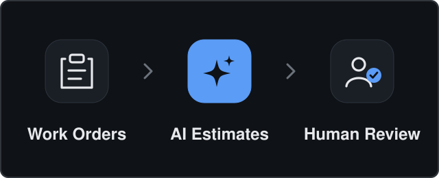
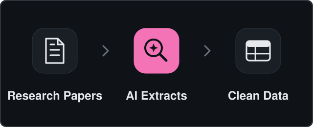
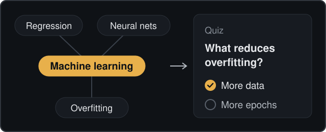
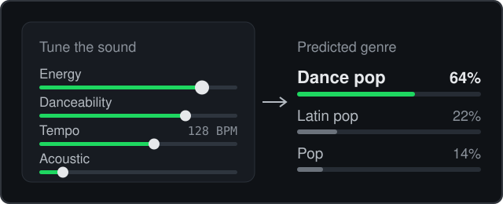

<h1 align="center">Hey, I'm Jayan</h1>

<strong>Software Engineering · Applied AI/ML · FDE · Full-Stack Development</strong> 
Computer Science @ <strong>Georgia Institute of Technology</strong> · Class of 2028 · Atlanta, GA

<a href="https://personal-website-local-lead.vercel.app">Portfolio</a> · <a href="https://www.linkedin.com/in/jayan-sirikonda/">LinkedIn</a> · <a href="mailto:jsirikonda3@gatech.edu">Email</a> · <a href="https://doi.org/10.47611/jsrhs.v13i2.6794">Publication</a>

---

## Featured Projects

<table>
<tr>
<td width="50%" valign="top">

<h3>PowerPlan · Enterprise AI Agent</h3>

An enterprise AI agent that estimates work-order units across a large capital backlog, combining hybrid RAG, concurrent LLM inference, human-in-the-loop review, and secure multi-tenant PostgreSQL infrastructure.

<code>Python</code> <code>LangGraph</code> <code>RAG</code> <code>PostgreSQL</code> <code>pgvector</code> <code>Databricks</code>

Proprietary Enterprise Work · No Public Source
</td>
<td width="50%" valign="top">

<h3>Georgia Tech · Grover Lab</h3>

An auditable LLM pipeline that transforms materials-science papers into structured research data through evidence-grounded extraction, document parsing, deterministic sample linking, and reproducible evaluations backed by 50+ automated tests.

<code>TypeScript</code> <code>Node.js</code> <code>LLMs</code> <code>Document AI</code> <code>PyMuPDF</code> <code>Docling</code>

Academic Research Work · No Public Source
</td>
</tr>
<tr>
<td width="50%" valign="top">

<h3><a href="https://github.com/gt-big-data/Smart-Path-AI">SmartPath AI</a></h3>

An AI-powered learning platform connecting document understanding, interactive knowledge graphs, contextual chat, and personalized quizzes. Improved graph connections and node deduplication, reducing graph redundancy by 40%.

<code>React</code> <code>TypeScript</code> <code>Node.js</code> <code>MongoDB</code> <code>React Flow</code> <code>Knowledge Graphs</code>

<a href="https://github.com/gt-big-data/Smart-Path-AI">Source ↗</a> · <a href="https://smart-path-ai-roan.vercel.app">Explore ↗</a>
</td>
<td width="50%" valign="top">

<h3><a href="https://github.com/sjayan009/Genrify">Genrify</a></h3>

A full-stack music genre classifier that predicts genres from Spotify audio features, combining scikit-learn model training, a FastAPI inference service, and interactive React visualizations for prediction confidence and model provenance.

<code>Python</code> <code>scikit-learn</code> <code>FastAPI</code> <code>React</code> <code>TypeScript</code> <code>Model Serving</code>

<a href="https://github.com/sjayan009/Genrify">Source ↗</a>
</td>
</tr>
</table>

---

## Tech Stack

<table>
<tr><th align="left">Category</th><th align="left">Tools</th></tr>
<tr>
<td><strong>Languages</strong></td>
<td>    </td>
</tr>
<tr>
<td><strong>Frontend</strong></td>
<td>   </td>
</tr>
<tr>
<td><strong>Backend &amp; Data</strong></td>
<td>      </td>
</tr>
<tr>
<td><strong>AI &amp; ML</strong></td>
<td>    </td>
</tr>
<tr>
<td><strong>Cloud &amp; DevOps</strong></td>
<td>       </td>
</tr>
</table>

---

## Let's Connect

I'm interested in **Summer 2027 Software Engineering and AI/ML Engineering internships**, research collaborations, and ambitious technical projects.

[**LinkedIn**](https://www.linkedin.com/in/jayan-sirikonda/) · [**Portfolio**](https://personal-website-local-lead.vercel.app) · [**Email**](mailto:jsirikonda3@gatech.edu)

